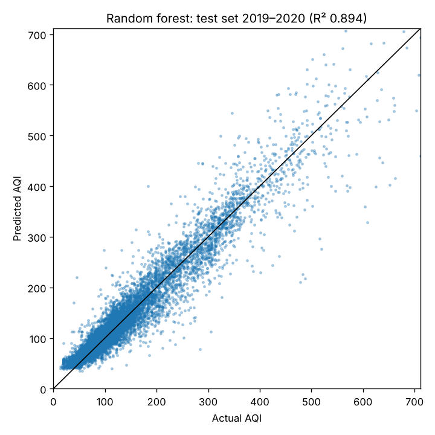

# AQI Predictor

Estimates the daily **Air Quality Index** (India CPCB scale) from 12 pollutant concentrations, acting as a "virtual sensor" when a station reports pollutants but no AQI. Includes a small Flask web app and JSON API.



## Results

Evaluated on a **chronological hold-out**: trained on 2015–2018 (13,358 city-days), tested on 2019 – Jul 2020 (11,492 city-days) that the model never saw. The model was chosen on a validation window (Jul–Dec 2018) *before* the test set was touched, so the figures below are not tuned to it.

| Model | R² | MAE | RMSE | Correct category | Category macro-F1 |
|---|---|---|---|---|---|
| Median baseline | 0.00 | 75.2 | 120.3 | 34.6% | 0.09 |
| Ridge regression | 0.861 | 25.8 | 44.8 | 69.3% | 0.64 |
| **Random forest (deployed)** | **0.894** | **19.2** | **39.1** | **76.5%** | **0.70** |
| Gradient boosting | 0.883 | 20.6 | 41.1 | 74.3% | 0.63 |

MAE/RMSE are in AQI points. "Correct category" means the predicted AQI falls in the same CPCB band as the actual AQI. Full output: [`model/metrics.json`](model/metrics.json). Per-category errors: [`docs/category_confusion.png`](docs/category_confusion.png) — almost all mistakes are between adjacent bands, but the model is weakest on **Good** days (only 26% recognised; most are called Satisfactory) because it tends to over-predict at the low end.

**Caveats:** AQI is itself calculated from pollutant sub-indices (using 24 h/8 h averages and only some of these 12 pollutants), so this is learning a known-ish function from incomplete daily averages rather than forecasting. Data covers 26 Indian cities; it won't transfer to other AQI scales (e.g. US EPA, UK DAQI) without retraining.

## AQI categories (CPCB)

| AQI | Category |
|---|---|
| 0–50 | Good |
| 51–100 | Satisfactory |
| 101–200 | Moderate |
| 201–300 | Poor |
| 301–400 | Very Poor |
| 401+ | Severe |

## Run it

```bash
git clone https://github.com/Advith023/aqi-predictor
cd aqi-predictor
python -m venv .venv && source .venv/bin/activate
pip install -r requirements.txt
python app.py            # http://127.0.0.1:5000
```

API:

```bash
curl -X POST http://127.0.0.1:5000/api/predict \
  -H "Content-Type: application/json" \
  -d '{"PM2.5": 80, "PM10": 150, "NO2": 30, "CO": 1.0, "O3": 35}'
# {"aqi": ..., "category": "..."}
```

Any pollutant can be omitted; missing values are imputed.

## Retrain

```bash
python train.py     # rewrites model/model.joblib, model/metrics.json and docs/*.png
pytest              # category boundaries, form + API validation
```

Retrain if you change scikit-learn version — the saved model is tied to the version in `requirements.txt`.

## Project layout

```
app.py                 Flask app (web form + /api/predict)
train.py               Chronological split, model comparison, metrics, plots
aqi/                   Shared feature list and AQI category logic
templates/, static/    Web UI
model/                 Trained model + metrics.json
data/city_day.csv      CPCB daily data, 2015–2020
notebooks/analysis.ipynb  Exploratory analysis
tests/                 pytest suite
```

## Data

`data/city_day.csv` is the daily city-level table from the *Air Quality Data in India (2015–2020)* dataset by Vopani on Kaggle, compiled from the Central Pollution Control Board (CPCB).

## Changelog

**2026-11** — Rebuilt: removed the login/registration system and its SQLite database (also purged from git history); fixed AQI category gaps (e.g. 50.5, 100, or >500 previously returned no category and crashed the page); restructured into `templates/`/`static/`; replaced the unsplit, leaky training with a chronological train/test split and published metrics; added input validation, a JSON API and tests; replaced the Python 3.6-era requirements; consolidated the two notebooks into one clean EDA notebook.
